# Swing Trading Agent (NSE)

A free, local, rule-based swing trading assistant for Indian stocks. Every evening it downloads daily prices, checks the market's health, scans the Nifty 100 for "pullback in an uptrend" setups, writes a trade plan (buy zone, stop-loss, target, quantity) for each one, and tells you what to do with the positions you already hold. A backtester runs the same rules over 10+ years of history.

> **Educational tool for personal use. Not investment advice.**
> The rules decide; nothing here is a recommendation. The tool never connects to a broker or places orders. You place trades yourself and log them here.

**Read the backtest section before trading any signal.** With the default settings, the strategy *lost money* in the 2015–2026 backtest while Nifty rose.

### Is this AI or machine learning?

**No. It's a rule-based system.** Every decision (which stock, buy zone, stop, target, quantity, when to exit) comes from fixed, readable rules and the numbers in `config.yaml`. Nothing is trained, nothing "learns" from data, and the same inputs always give the same output.

| Question | Answer |
|---|---|
| Does it need an AI model to work? | **No.** Everything runs without one. |
| Is there any AI at all? | One **optional** extra: a small local language model (via [Ollama](https://ollama.com)) can rewrite each signal's reasons as a short paragraph. It only *explains*; it can't change a number or a decision, and every reply is checked. If it's off or missing, you lose nothing but that paragraph. |
| Does it need the internet or paid APIs? | Only free Yahoo Finance data (and optionally the niftyindices.com list). No keys, no accounts, no broker connection. |
| What "algorithms" does it use? | Classic technical analysis (EMA, RSI, ATR, relative strength), a fixed checklist, a ranking formula, fixed-fractional position sizing and an event-driven backtester. All are explained in [section 9](#9-how-it-works-the-algorithm). |

### What it looks like

| Today's signals | Analyze any stock |
|---|---|
| 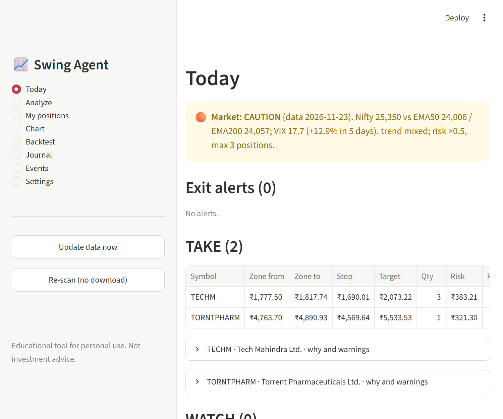 | 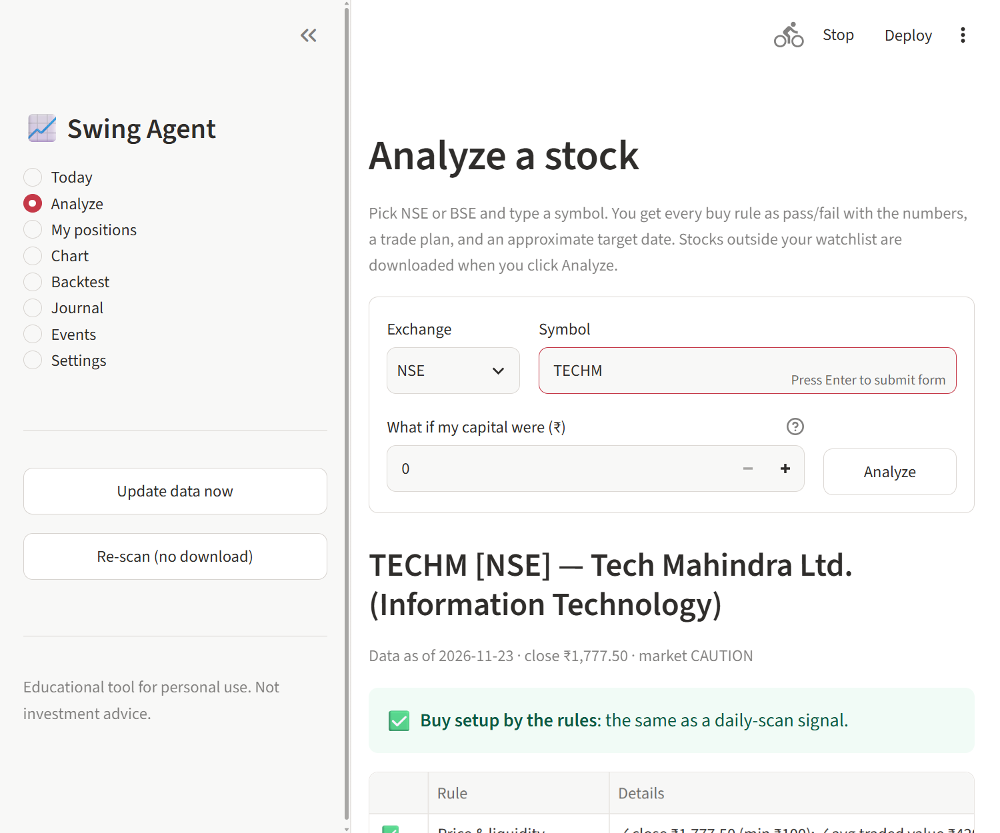 |
| **Rule checklist** | **Trade plan and target date** |
| 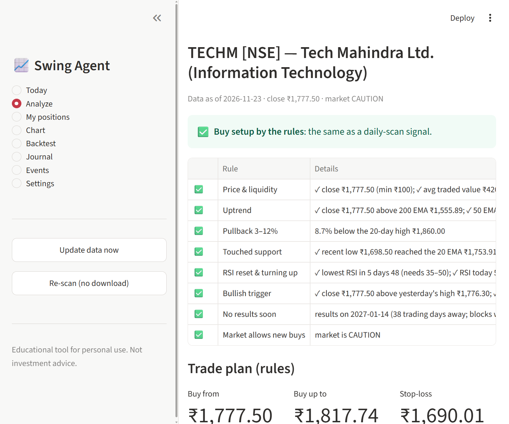 | 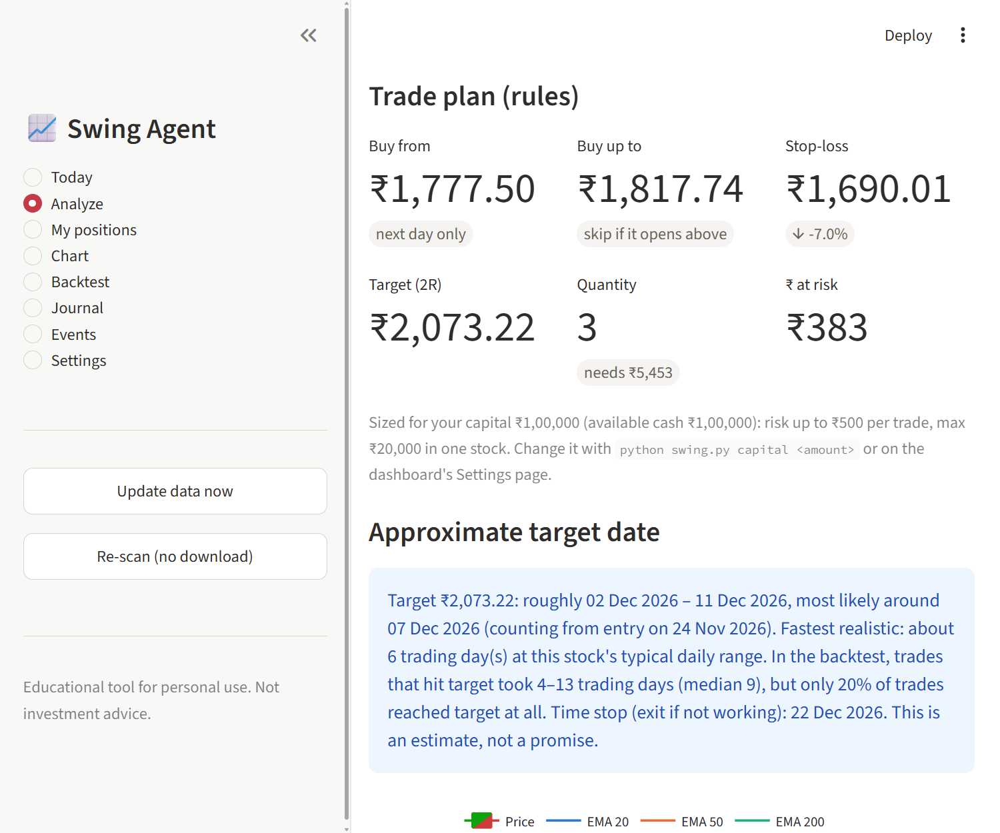 |
| **Chart with plan levels** | **Backtest: strategy vs Nifty** |
| 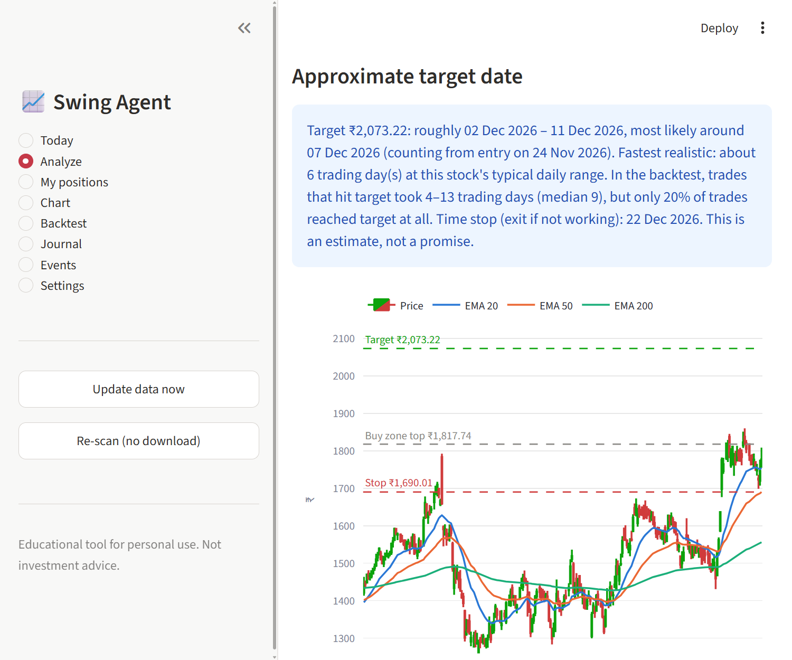 | 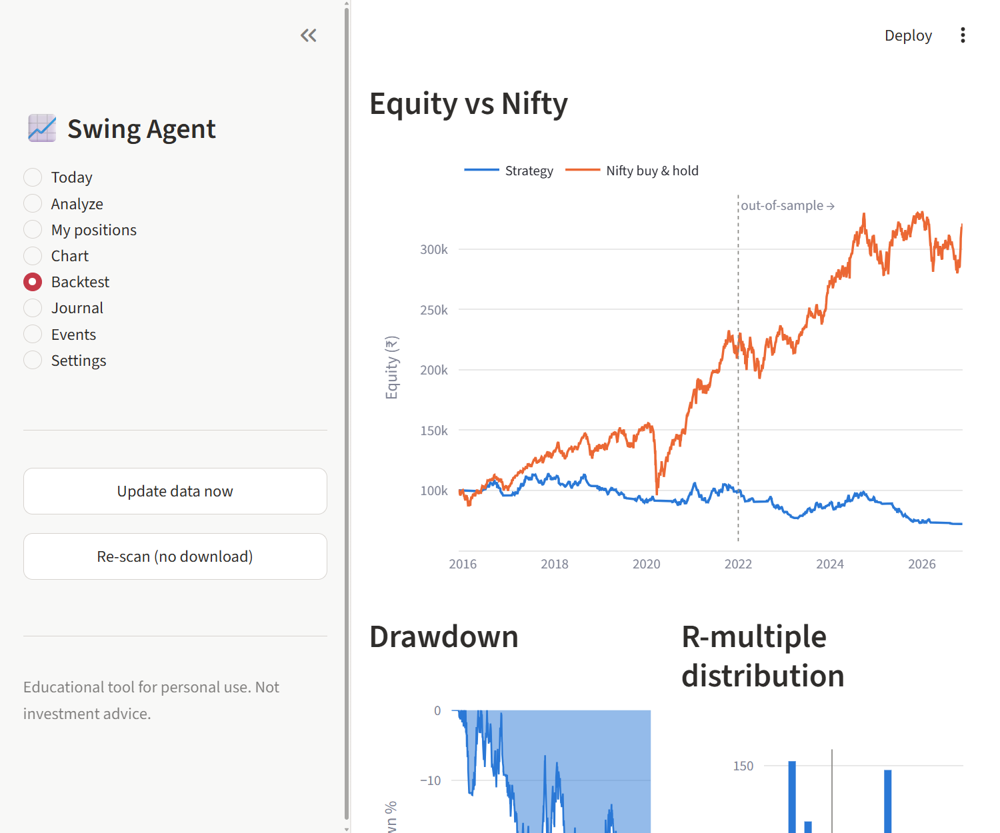 |

<sub>Screenshots use a demo copy of the data with ₹1,00,000 capital and no trades.</sub>

---

## Contents

1. [Install](#1-install)
2. [First run](#2-first-run)
3. [Daily routine](#3-daily-routine)
4. [Logging your trades](#4-logging-your-trades)
5. [Event calendar](#5-event-calendar)
6. [Scheduling the daily run](#6-scheduling-the-daily-run)
7. [Dashboard](#7-dashboard)
8. [Backtesting](#8-backtesting)
9. [How it works: the algorithm](#9-how-it-works-the-algorithm)
10. [Architecture](#10-architecture)
11. [Configuration (`config.yaml`)](#11-configuration-configyaml)
12. [Troubleshooting](#12-troubleshooting)
13. [Project layout and tests](#13-project-layout-and-tests)

---

## 1. Install

You need **Python 3.11 or newer** and an internet connection for the daily download. Nothing else: no API keys, no paid data.

**Windows (PowerShell or Command Prompt)**

```bat
cd path\to\tradeagent
py -3.12 -m venv .venv
.venv\Scripts\python.exe -m pip install -r requirements.txt
```

**macOS / Linux**

```sh
cd path/to/tradeagent
python3 -m venv .venv
.venv/bin/python -m pip install -r requirements.txt
```

In the commands below, `python` means the virtual-environment Python: `.venv\Scripts\python.exe` on Windows, `.venv/bin/python` on macOS/Linux. Activating the venv (`.venv\Scripts\activate` or `source .venv/bin/activate`) lets you type plain `python`.

## 2. First run

```sh
python swing.py init
```

This creates `data/market.db`, loads the watchlist (`data/watchlists/nifty100.csv`) and downloads about 12 years of daily prices for the 100 stocks plus Nifty 50 and India VIX. It takes about a minute.

Optional, but worth doing once: get the current official Nifty 100 list.

```sh
python swing.py watchlist --refresh
python swing.py update
```

If the download from niftyindices.com fails, the existing list is kept and the command prints how to update it by hand.

**Set your capital**: the money you've set aside for swing trading. Every quantity and ₹-at-risk figure is calculated from it:

```sh
python swing.py capital 250000      # set it (₹2,50,000)
python swing.py capital             # show capital, cash, risk per trade and max per stock
```

You can also change it on the dashboard's **Settings** page. Your live capital is this starting amount plus the profit or loss of trades you've closed.

Then look at today's scan:

```sh
python swing.py scan
```

## 3. Daily routine

After the market closes (data is final after about 4 pm IST; the default schedule is 6:30 pm):

```sh
python swing.py run
```

`run` downloads the new bars, refreshes results dates (weekly), syncs your event calendar, scans, sizes the signals, checks your open positions and saves:

- the signals and alerts in the database (re-running the same day replaces them; no duplicates)
- a report in `reports/YYYY-MM-DD.md`

The report contains, in order: the market regime, data warnings, **exit alerts** for your positions (most urgent first), your positions, **TAKE** signals (up to your free position slots), **WATCH** signals, upcoming events and the scan funnel.

Then, in the evening:

1. Act on exit alerts: stop hit, target hit, trend broken, time stop, results soon, move stop to breakeven.
2. For each TAKE signal you want: next morning, buy only if the stock opens **inside the buy zone**. If it gaps above the zone, skip it, don't chase.
3. **Place a real stop-loss or GTT order with your broker.** This tool only checks once a day after the close.
4. Log what you actually did (next section).

`python swing.py scan` shows the same report without downloading or saving anything. Use `scan --date 2024-03-15` to see what the rules said on a past day.

If the download fails (no internet), `run` uses the cached data and warns that it may be stale.

### Analyse any stock you choose

```sh
python swing.py analyze TCS
python swing.py analyze IRCTC --add      # also add it to the watchlist for the daily scan
```

or open the dashboard's **Analyze** page and type a symbol. It works for any NSE stock: if its prices aren't stored yet they are downloaded on the spot (`--no-download` to stay offline). You get:

- **Verdict:** "buy setup by the rules" (exactly what the daily scan would say) or "no setup today".
- **Rule checklist:** every buy rule as ✅/❌ with the numbers, and ✓/✗ for each part, e.g. "✗ 50 EMA ₹2,357 above 200 EMA".
- **Trade plan:** the real plan for a setup, or a clearly labelled *hypothetical* plan ("IF you bought at today's close") when it isn't one. The hypothetical plan is information, not a signal.
- **Approximate target date** (see below) and a chart with entry, stop and target lines.

### Approximate target date

Every signal, and every analysis, shows a rough window for reaching the target, for example *"about 02 Dec – 11 Dec 2026 (most likely ~07 Dec); time stop 22 Dec"*. It combines:

1. **This stock's speed:** how many days its typical daily range (ATR) needs to cover the distance to the target (the fastest realistic case).
2. **History:** how long winning trades took in your latest backtest (`python swing.py backtest`), for example 4–13 trading days, median 9.

Dates count weekdays from the next trading day (exchange holidays aren't excluded). **It is an estimate, not a promise:** in the backtest only about 1 in 5 trades reached its target at all; the rest exited at the stop, on a trend break or at the 20-day time stop.

## 4. Logging your trades

The tool never sees your broker account, so log every buy and sell:

```sh
python swing.py trade buy TECHM --price 1815 --qty 3
python swing.py trade sell TECHM --price 1900 --qty 3
python swing.py trade list
```

- **Buy:** if you don't give `--stop`, the stop comes from the latest signal for that stock. The target defaults to 2R from *your* fill price. Charges are estimated unless you pass `--fees` with the real amount from your contract note. `--date 2026-11-24` logs a past trade.
- **Sell:** partial sells are fine; they are matched first-in-first-out.
- **Move stop:** `python swing.py trade move-stop TECHM --stop 1815` (for example after a MOVE_STOP alert). Your R stays measured from the original stop.
- **Fix a mistake:** `trade list` shows ids; `python swing.py trade delete 7` removes one.

Positions, cash, capital and P&L are always rebuilt from this log. Capital = `account.capital` + realised P&L after charges.

## 5. Event calendar

Results dates matter: the scanner skips a stock with results within 5 trading days, and the exit check warns 3 days before results on a stock you hold.

**Results dates are fetched automatically** from Yahoo Finance once a week (about 1–2 minutes during `run`). They are a best-effort estimate; check the date on NSE before relying on it. Fetch now with:

```sh
python swing.py events fetch
```

**Market-wide events you should add yourself each year**: RBI monetary policy dates, the Union Budget, US Fed (FOMC) meetings, election results and anything else that moves the market. Put them in **`data/events.csv`**, which is synced on every `run`:

```csv
date,symbol,type,note
2027-02-01,ALL,BUDGET,Union Budget
2027-01-14,TECHM,RESULTS,Q3 results (confirmed on NSE)
```

- `symbol`: an NSE symbol, or `ALL` for market-wide events.
- `type`: one of `RESULTS`, `RBI`, `BUDGET`, `FED`, `ELECTION`, `OTHER`.
- Editing or deleting a row in the CSV changes the calendar on the next `run` (or `python swing.py events sync`).

Quick one-off additions: `python swing.py events add --date 2027-02-06 --symbol ALL --type RBI --note "policy"`. List with `python swing.py events list`. The dashboard's Events page can add, delete and import CSVs too.

## 6. Scheduling the daily run

```sh
python swing.py schedule
```

prints the exact command for your operating system, with the IST run time (`schedule.run_time_ist`, default 18:30) converted to your computer's time zone.

**Windows.** Run once:

```bat
python swing.py schedule --install
```

This registers a Task Scheduler task called `SwingAgentDaily` that runs `swing.py run` on weekdays. It runs **hidden** (`pythonw.exe`, so there's no console window to close by accident) and, if the computer was off or asleep at the scheduled time, it **runs as soon as the computer is back**. The report and any error are appended to `logs\scheduled_run.log`.

- Check it: `schtasks /Query /TN "SwingAgentDaily"`
- Run it now: `schtasks /Run /TN "SwingAgentDaily"`
- Remove it: `schtasks /Delete /TN "SwingAgentDaily" /F`

`scripts\run_daily.bat` does the same run when double-clicked. `swing.py schedule` (without `--install`) also prints a plain `schtasks` command; that version shows a console window and doesn't catch up missed runs.

**macOS / Linux.** Make the script executable and add a cron line (`crontab -e`). Cron uses the machine's local time, so use the time `swing.py schedule` prints. On an IST machine:

```sh
chmod +x scripts/run_daily.sh
# crontab line: weekdays at 18:30
30 18 * * 1-5 "/path/to/tradeagent/scripts/run_daily.sh"
```

On macOS, cron may need Full Disk Access (System Settings → Privacy & Security) to reach your project folder.

On macOS/Linux, cron skips runs while the computer is off or asleep. On any system you can run `python swing.py run` yourself, or click **Update data now** in the dashboard.

## 7. Dashboard

```sh
python swing.py dashboard
```

Opens http://localhost:8501 in your browser (Ctrl+C in the terminal to stop it). By default only this computer can connect.

**Use it from your phone or another PC at home:**

```sh
python swing.py dashboard --lan
```

This prints an address like `http://192.168.1.20:8501`; open it on any device on the same Wi-Fi/router. The dashboard has **no login**: anyone on that network can see your positions and change your trade log, so only use `--lan` on your own home network, never on café, office or hotel Wi-Fi. If the phone can't connect, allow Python through Windows Firewall for **Private** networks and set your home network to Private (Settings → Network & internet → your connection → Private network). It is not reachable from the internet; that would need a login first.

| Page | What it shows |
|---|---|
| **Today** | Market regime banner (green / amber / red), exit alerts, TAKE and WATCH tables. Expand a signal for its reasons and warnings; **Log this buy** fills in the buy form. |
| **Analyze** | Pick NSE or BSE, type any symbol: rule checklist, trade plan (real or hypothetical), approximate target date, chart. Optional *what if my capital were* box. |
| **My positions** | Capital, cash, P&L in ₹, % and R, status, stop, target, days held. Log a sell, confirm a breakeven stop move, view or fix the trade log. |
| **Chart** | Candles with EMA 20/50/200, volume and RSI panels, and entry/stop/target lines when a signal or position exists. |
| **Backtest** | Run a new backtest or open a past one: metrics, equity vs Nifty, drawdown, R-multiple distribution, yearly table, trades. |
| **Journal** | Your real closed trades with win rate, expectancy (R) and net P&L. |
| **Events** | View, add, delete and import calendar entries. |
| **Settings** | Change your capital; view `config.yaml` and whether it is valid. |

The dashboard only reads the local database. It downloads data only when you click **Update data now** (or **Re-scan**, which scans without downloading).

## 8. Backtesting

```sh
python swing.py backtest
python swing.py backtest --start 2018-01-01 --end 2023-12-31
```

The backtester replays every trading day using the **same functions** as the live scan, sizing and exit checks. Entries fill at the next day's open (skipped if it gaps above the buy zone or opens below the stop); stops fill at the stop or the gap-down open; targets at the target or the gap-up open; if a stop and target are hit on the same day it assumes the stop; trend and time exits fill at the next open. Charges and 0.1% slippage apply to every fill. Results-date filters are not applied (no free history of NSE results dates).

Output goes to `reports/backtest_<timestamp>/`: `summary.md`, `trades.csv`, `equity.csv`. Results are reported for **in-sample** (to `backtest.in_sample_end`, default end of 2021), **out-of-sample** (after it) and the full period, against Nifty buy-and-hold.

**What the default strategy did (2015-11-27 to 2026-11-19, ₹1,00,000 start):**

| | Strategy | Nifty buy & hold |
|---|---:|---:|
| CAGR, full period | −2.9% | +11.2% |
| CAGR, out-of-sample (2022–2026) | −6.4% | +8.2% |
| Max drawdown | −36.8% | −38.4% |
| Trades / win rate / expectancy | 820 / 33% / −0.05R | |

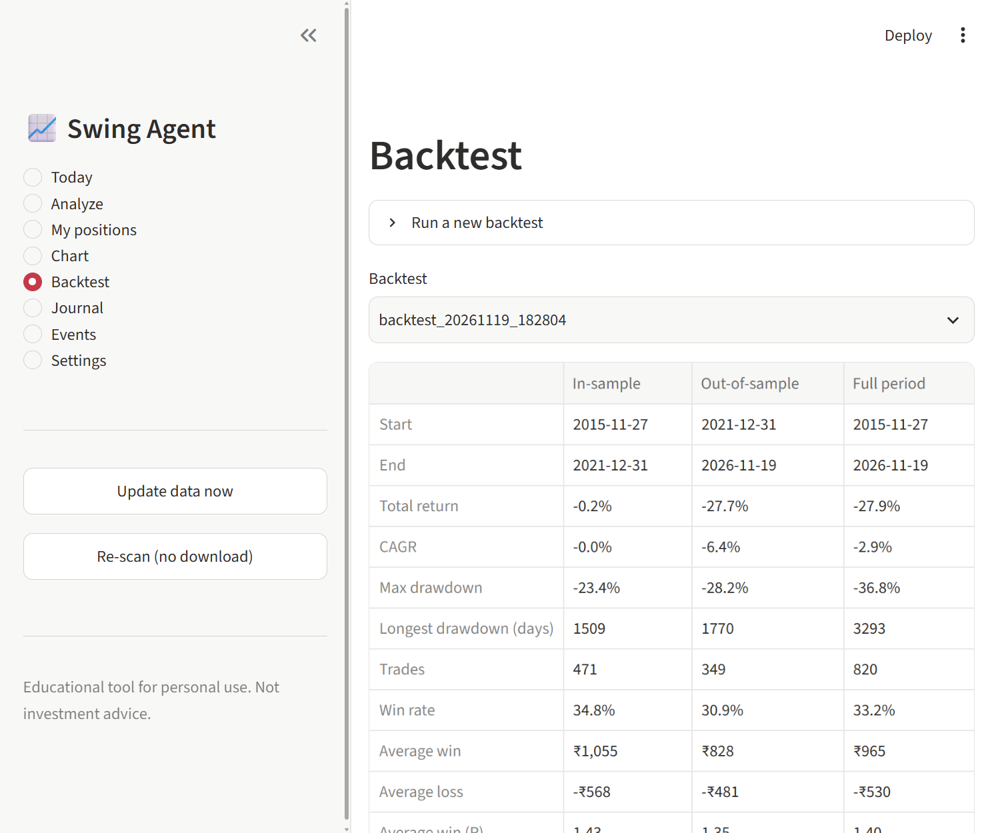

Before charges the rules had a thin edge (about +0.10R per trade); charges on small positions (about 0.15R per trade at ₹1 lakh capital with ₹20 brokerage) turned it negative. Trend exits (close below the 50 EMA) were the biggest losers. A small sweep of nearby settings lost money in every combination. Treat the daily signals as a starting point for your own judgement, not as a proven system.

**Parameter sensitivity:**

```sh
python swing.py backtest --sweep target_r=1.5,2,2.5 rsi_dip_max=45,50,55
```

runs a small grid and saves a table to `reports/sweep_<timestamp>.csv`. Use it to see whether results are *stable* across nearby values, not to pick the best one. Keys can be written as `section.key` (e.g. `costs.brokerage_per_order=20,0`).

Every summary repeats these warnings:

- **Survivorship bias:** today's Nifty 100 list is applied to past years. Stocks that dropped out of the index are missing, which overstates results.
- Fills are modelled on daily bars; real fills, slippage and gaps differ.
- Past performance doesn't guarantee future results.
- Don't keep tuning parameters until the backtest looks good. Judge any change on its out-of-sample results.

## 9. How it works: the algorithm

The whole system is a fixed pipeline of rules. Signals are computed on the **close of day T**; you act on **day T+1**. Every number below is a setting in `config.yaml`.

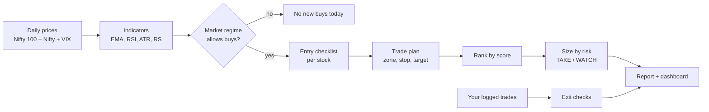

### Step 1. Indicators

Calculated per stock from daily open/high/low/close/volume. All of them are *causal*: the value on a day uses only that day and earlier days, so the backtest can't peek into the future.

| Indicator | Formula (plain words) | Used for |
|---|---|---|
| **EMA 20 / 50 / 200** | Exponential moving average of the close; recent days weigh more (`span = n`) | trend direction and support |
| **RSI 14** (Wilder) | 100 − 100 / (1 + average gain ÷ average loss), smoothed over 14 days | "has the dip cooled off?" |
| **ATR 14** (Wilder) | average of the true range (the biggest of high−low, \|high−prev close\|, \|low−prev close\|) | how far the stock typically moves in a day |
| **Average traded value** | 20-day mean of close × volume, in ₹ crore | liquidity filter |
| **Relative strength** | stock's 63-day return − Nifty's 63-day return, in % points | ranking |
| **Volume vs average** | today's volume ÷ the previous 20 days' average | ranking bonus |

### Step 2. Market regime (the "traffic light")

Checked first, from Nifty 50 and India VIX:

| Regime | Condition | Effect |
|---|---|---|
| 🟢 BULLISH | Nifty > 50 EMA and 50 EMA > 200 EMA | normal risk |
| 🟠 CAUTION | Nifty > 200 EMA but not BULLISH | half risk, max 3 positions |
| 🔴 BEARISH | Nifty < 200 EMA | no new entries |
| 🔴 FEAR | VIX > 25, or VIX up > 30% in 5 days | no new entries |

### Step 3. Entry checklist ("pullback in an uptrend")

A stock is a setup only if **every** line holds on day T:

1. **Tradeable:** price ≥ ₹100, 20-day average traded value ≥ ₹20 crore, 250+ days of history.
2. **Uptrend:** close > 200 EMA, 50 EMA > 200 EMA, and the 200 EMA is rising.
3. **Pullback:** 3–12% below its 20-day high (a dip, not a crash).
4. **Support held:** a low in the last few days touched the 20 EMA, and the close is still above the 50 EMA.
5. **RSI reset:** RSI dipped into 35–50 recently and is now turning up.
6. **Bullish trigger:** close above yesterday's high, above the 20 EMA, and above today's open.
7. **No results soon:** no results date within 5 trading days.
8. **Regime allows entries** (step 2).

The idea: buy a strong stock after a short, orderly dip, on the day it starts to bounce.

### Step 4. Trade plan

- **Buy zone** = day-T close to day-T high + 0.5%, valid on the next day only. If the stock opens above it, skip it.
- **Stop-loss** = the lowest low of the last 5 days − 0.5%, but at least 1 × ATR below entry. If that stop is more than 8% away, the signal is rejected.
- **R** (risk per share) = entry − stop. **Target** = entry + 2R.
- **Estimated charges** for the round trip (brokerage, STT, exchange, SEBI, stamp duty, GST, DP charge).

### Step 5. Ranking and sizing

- **Score** = relative strength vs Nifty + 2 × bonus points (1 point for volume drying up during the pullback, 1 for above-average volume on the trigger day).
- The best scores fill your **free position slots** (TAKE), with at most 2 stocks per sector. The rest are WATCH.
- **Quantity** (fixed-fractional sizing):

  ```
  risk budget = capital × 1%          (× 0.5 in CAUTION)
  quantity    = floor(risk budget ÷ R)
  then capped so one stock ≤ 20% of capital, and by the cash you have free
  ```

  So a stop-out loses about 1% of your capital, whatever the stock's price.

### Step 6. Exit checks for positions you hold

Run every evening on the trades you logged, first match wins:

| Priority | Alert | When |
|---|---|---|
| 1 | STOP_HIT | low ≤ stop |
| 2 | TARGET_HIT | high ≥ target |
| 3 | MOVE_STOP | close is 1R or more above entry and the stop is still below entry → move it to breakeven |
| 4 | TREND_EXIT | close below the 50 EMA |
| 5 | TIME_EXIT | held 20 trading days (the trade isn't working) |
| 6 | RESULTS_SOON | results within 3 trading days |
| – | HOLD | none of the above |

In BEARISH or FEAR markets every position also gets "Market weak. Consider tightening stops."

### Step 7. Approximate target date

```
fastest days  = ceil((target − entry) ÷ ATR)          the stock's own speed
history       = how long winning backtest trades took  (25th, 50th, 75th percentile)
window        = history percentiles, never faster than "fastest", never past the time stop
dates         = counted in weekdays from the next trading day
```

Without a backtest it falls back to the ATR estimate only (×1, ×2, ×3).

### Step 8. Backtester

An **event-driven day-by-day replay** of the same functions the live scan uses (no separate "backtest version" of the rules):

- each day: check exits for open positions, then scan, rank and size new signals with the cash available that day;
- entries fill at the next day's open, but only inside the buy zone; stops, targets and gaps fill realistically (stop first if both hit the same day);
- every fill pays charges and 0.1% slippage;
- results are split into **in-sample** (to end-2021) and **out-of-sample** (2022 on) and compared with Nifty buy-and-hold.

### Step 9. Optional AI explanation (not part of the decision)

If enabled, the signal's numbers and reasons go to a local Ollama model with the instruction "explain, don't change". The reply is rejected (and the plain reasons shown instead) if it contains any number that isn't in the facts, or advice words like "avoid" or "sell".

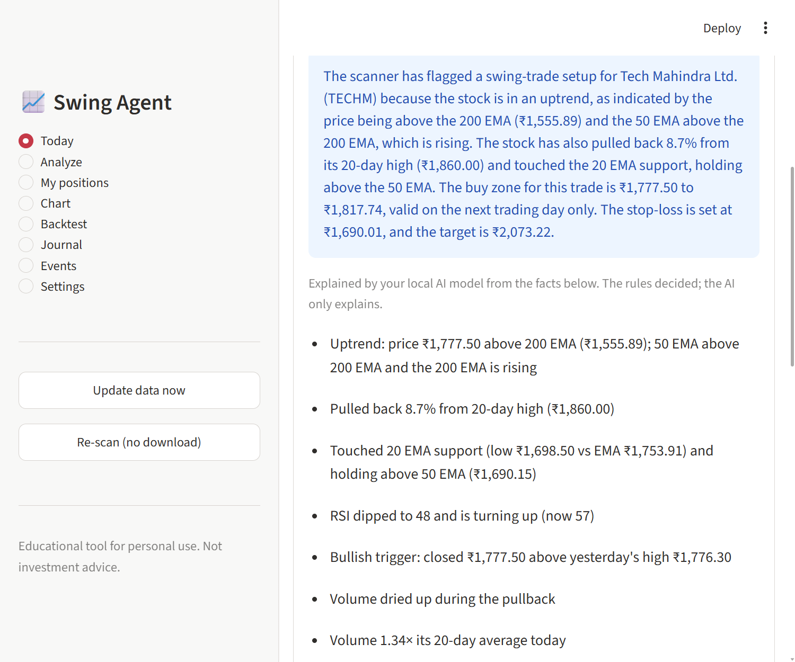

Every signal also carries its plain-English reasons, e.g. "Pulled back 6.2% from 20-day high" and "RSI dipped to 41 and is turning up".

## 10. Architecture

### Big picture

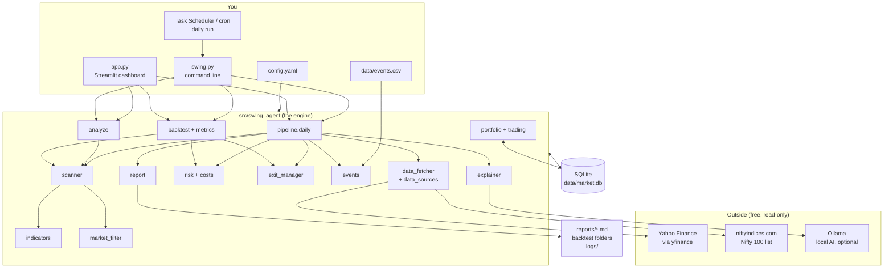

**Three ways in, one engine.** The command line, the dashboard and the scheduled task all call the same functions in `src/swing_agent`. The dashboard has no logic of its own; it displays what the engine returns.

### What happens in one daily run

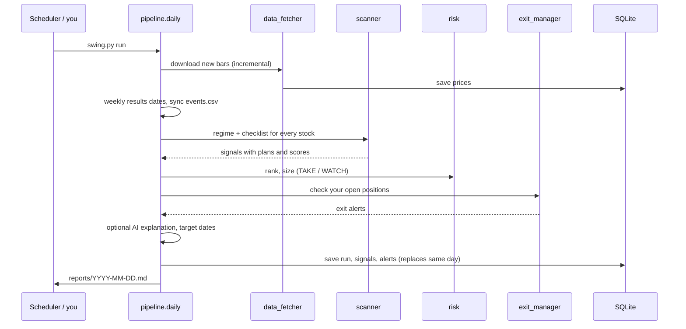

### Modules

| Layer | Module | Job |
|---|---|---|
| **Entry points** | `swing.py` | every command: init, update, run, scan, analyze, trade, capital, backtest, events, schedule, dashboard |
| | `app.py` | the Streamlit dashboard |
| **Orchestration** | `pipeline.py` | the daily run, step by step (above) |
| | `scheduling.py` | builds the Task Scheduler / cron commands |
| **Data** | `data_sources/` | pluggable price source (`base.py` interface, `yfinance_source.py`) |
| | `data_fetcher.py` | incremental download, cleaning, bad-bar removal |
| | `watchlist.py` | the Nifty 100 list (CSV, refresh from niftyindices.com) |
| | `events.py` | results dates and market events (CSV sync, Yahoo fetch) |
| | `db.py` | SQLite schema, migrations, all reads and writes |
| **Strategy** | `indicators.py` | EMA, RSI, ATR, traded value, relative strength |
| | `market_filter.py` | market regime |
| | `scanner.py` | entry checklist, trade plan, reasons, score, ranking |
| | `risk.py` | position sizing |
| | `costs.py` | Indian delivery charges and slippage |
| | `exit_manager.py` | exit rules for open positions |
| **Your account** | `portfolio.py` | rebuilds positions, cash and P&L from the trade log (FIFO) |
| | `trading.py` | logging buys, sells, stop moves |
| **Tools** | `analyze.py` | any-stock analysis, what-if capital, target-date estimate |
| | `backtest.py`, `metrics.py` | the replay and its statistics |
| | `explainer.py` | optional Ollama explanation with faithfulness checks |
| | `report.py`, `fmt.py` | Markdown report, ₹ formatting with Indian grouping |
| | `config.py`, `logging_setup.py` | validated settings, log files |

### Data storage (`data/market.db`)

| Table | Holds |
|---|---|
| `symbols` | watchlist stocks: symbol, name, sector, active flag |
| `prices` | daily OHLCV bars per symbol (about 12 years) |
| `events` | results dates and market-wide events |
| `runs` | one row per daily run: date, status, last data date, regime |
| `signals` | each run's TAKE/WATCH signals with plan, reasons, explanation, target date |
| `alerts` | each run's exit alerts |
| `trades` | your logged buys and sells (the source of truth for positions) |

New columns are added by small migrations on start, so an old database keeps working.

### Design decisions

- **Same code for live and backtest.** `scanner`, `risk`, `costs` and `exit_manager` are shared, so the backtest tests exactly what you'd trade.
- **No look-ahead.** Indicators are causal; the backtest only sees data up to each replayed day.
- **Everything configurable, everything validated.** A wrong value in `config.yaml` stops the program with a message naming the field.
- **Your trade log is the truth.** Positions, cash and capital are always recomputed from it; nothing is stored twice.
- **Offline-first.** If a download fails, cached data is used with a warning. The AI explainer fails silently back to plain reasons.
- **Never touches a broker.** It can't place, change or see real orders.
- **Tested offline.** About 150 tests run on synthetic price data, including the dashboard pages.

## 11. Configuration (`config.yaml`)

Every number the strategy uses lives in `config.yaml`. It is checked when any command starts; a bad value stops with a message naming the field (e.g. `entry.pullback_min_pct must be smaller than pullback_max_pct`).

| Section | What to change there |
|---|---|
| `account` | **`capital`** (your trading capital in ₹), `risk_per_trade_pct`, `max_open_positions`, `max_position_pct`, `max_per_sector` |
| `universe` | `watchlist_file` (any CSV with `symbol,name,sector`), minimum price, liquidity and history |
| `data` | years of history, index and VIX symbols, `events_file`, `fetch_results_dates` |
| `market_filter` | regime EMAs, VIX limits, CAUTION risk multiplier and position cap |
| `entry` | the entry rules above (EMAs, pullback range, RSI dip range, buy-zone buffer, results gap) |
| `stops_targets` | stop buffer, ATR floor, max stop %, target R, breakeven trigger, trend-exit EMA, time stop, results warning |
| `costs` | **check these against your broker**: brokerage per order, STT, exchange, SEBI, stamp duty, GST, DP charge, slippage |
| `backtest` | start date, in-sample end, starting capital |
| `schedule` | `run_time_ist` used by `swing.py schedule` |
| `explainer` | optional plain-English explanations from a local Ollama model (see below) |

Set `costs.brokerage_per_order: 0` if your broker charges nothing for delivery trades; it noticeably changes the backtest.

### Optional: plain-English explanations with a local AI model

If [Ollama](https://ollama.com) is installed and running, each signal in the report and on the dashboard's Today page also gets a 3–4 sentence explanation written by a local model. Nothing leaves your computer.

```yaml
explainer:
  enabled: true
  ollama_url: "http://localhost:11434"
  model: "llama3.2:3b"     # any model you have pulled: `ollama pull llama3.1:8b` is better but slower
```

- **The rules decide; the model only explains.** It receives the signal's numbers and reason strings and is told not to change numbers or recommend anything different.
- Every reply is checked. If it contains a number that isn't in the facts, or wording like "avoid" or "sell", it is thrown away and the rule-based reasons are shown instead.
- If Ollama isn't running, the model isn't installed or a reply is too slow, the tool silently uses the rule-based reasons. A run never waits more than about 3 minutes for explanations (the first one is slow while the model loads).
- Set `enabled: false` to switch it off.

## 12. Troubleshooting

| Problem | What to do |
|---|---|
| `No Nifty data in the database` | Run `python swing.py init`. |
| "Every download failed" / stale-data warning | Check your internet connection and run `python swing.py run` again. Cached data is used meanwhile. |
| A stock is "older than Nifty's" latest bar | Yahoo sometimes publishes a stock's bar late. It is skipped that day and catches up on the next update. |
| A symbol fails to download | It may have been renamed or removed (e.g. LTIM became LTM). Run `python swing.py watchlist --refresh`. |
| `The database is locked` | Another run or the dashboard is writing. Wait a moment and retry. |
| `Invalid config.yaml` | The message names the field and the problem. |
| Need detail | Everything is logged to `logs/swing.log`; scheduled runs also write `logs/scheduled_run.log`. |

To experiment without touching your real data, copy `data/market.db` and set `SWING_AGENT_DB` to the copy's path before running commands. `SWING_AGENT_CONFIG` does the same for a copy of `config.yaml`, and `SWING_AGENT_REPORTS` for the reports folder.

## 13. Project layout and tests

```
swing.py            command-line entry point (every command)
app.py              Streamlit dashboard (8 pages)
config.yaml         all settings, validated on start
data/               market.db, watchlists/nifty100.csv, events.csv
reports/            daily reports, backtests, sweeps
logs/               swing.log, scheduled_run.log
docs/screenshots/   images used in this README
scripts/            run_daily.bat (Windows), run_daily.sh (macOS/Linux)
src/swing_agent/    the code; see "Modules" in section 10
tests/              offline tests on synthetic data (no internet)
```

Run the tests (no internet needed):

```sh
python -m pytest
```

---

*Educational tool for personal use. Not investment advice. Prices come from Yahoo Finance via the unofficial `yfinance` library and may be delayed, adjusted or wrong; verify before trading.*
